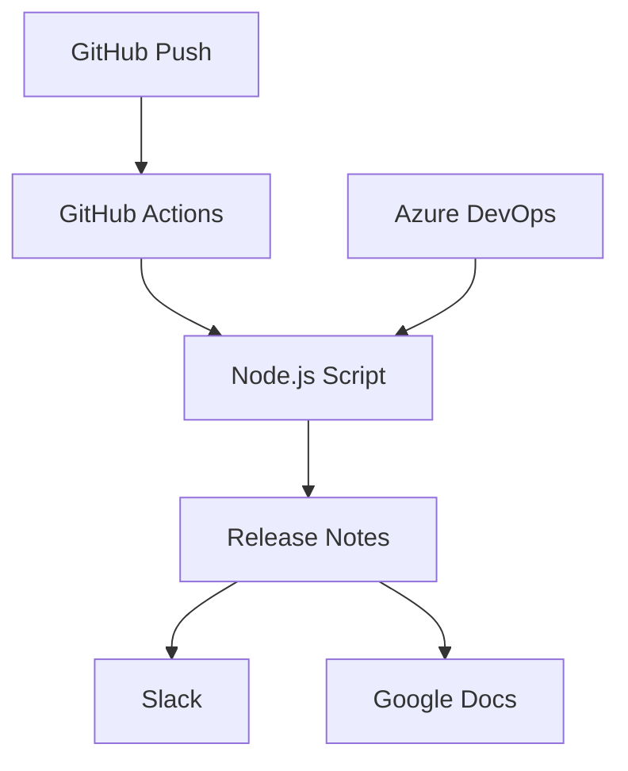

# Release Notes Automation


## About the Project

This project aims to automate the generation of release
notes, transforming commits and Azure DevOps work items
into structured and readable documentation.

The main goal is to reduce manual work and improve
communication between development teams and stakeholders.

## Project Goals

- Automated release notes generation
- Azure DevOps integration
- Slack notifications
- Google Docs integration
- Categorization of changes
- Integration with GitHub Actions

## Technologies

- JavaScript
- Node.js
- GitHub Actions
- Azure DevOps API
- Slack Webhooks
- Google Docs API

## Architecture



## Release Notes Format

- Features
- Bug Fixes
- Technical Debt

Each entry can include its work item ID, title
and a short description of the changes.

## Installation

Clone the repository:

```bash
git clone https://github.com/PedroAmaral23/release-notes.git
cd release-notes
npm ci
```

## Configuration

Configure the required GitHub Actions secrets
according to the workflow configuration:

- AZURE_TOKEN
- SLACK_WEBHOOK_URL
- GOOGLE_CREDENTIALS

Never commit credentials or access tokens.

## Project Status

Experimental automation project.

## Author

Pedro H. Teixeira Amaral

- [LinkedIn](https://www.linkedin.com/in/pedro-h-teixeira-amaral-8266923a7/)
- [Portfolio](https://portifolio-pedro-amaral.vercel.app/)
